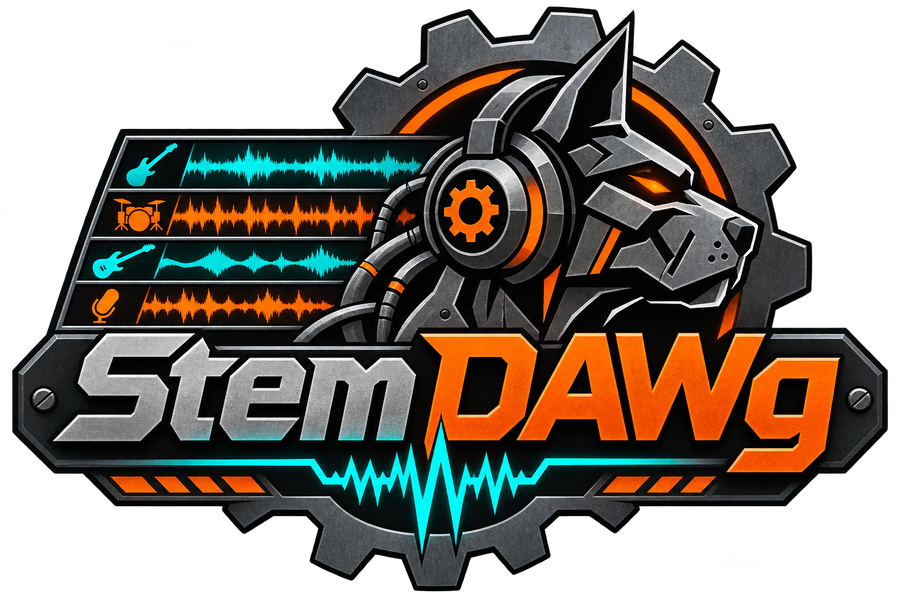

<p align="center">
  
</p>

<p align="center">
  <b>Clean up AI-generated stems and home recordings. Balance them. Master them.</b><br>
  Built for industrial, EBM and techno first.
</p>

<p align="center">
  <a href="https://github.com/Deverydoo/Stem-DAWg/actions/workflows/ci.yml"></a>
  <a href="LICENSE"></a>
  
</p>

---

**Stem DAWg** is a music cleaner and mastering tool. It is not another general-purpose DAW. You load the stems from Suno (or any stem export) or your own recordings, and it helps you remove what ruins them: separation bleed, noise beds, fan hiss, harsh and phasey high ends, stems that sum into clipping. Then you balance and master the result.

> **Status: early development (Milestone 1 complete).** It plays, mixes and exports stems today. The cleaning and mastering tools are next; see the [roadmap](docs/ROADMAP.md).

## What works today

- **Stem mixer, Suno Studio–style:** a coloured lane per stem with mute, solo, volume and pan. Every mixer change is declicked.
- **Real-time engine:** zero allocations in the audio callback (enforced by tests), sample-exact playback, WASAPI / DirectSound (ASIO optional).
- **Projects:** versioned `project.json`, atomic saves, backups, autosave and recovery, stems copied into the project folder.
- **Export Mix:** renders the whole song at the project's sample rate to WAV (24-bit, 16-bit dithered, 32-bit float), with clipping detection.
- **Artist profiles:** enter your artist details once (artist, label, copyright, genre, website, cover art) and every export gets RIFF INFO and ID3v2.3 tags plus embedded artwork. Switch between artists in the toolbar.
- **AI built in:** ONNX Runtime inference and background analyzers for levels, transients, spectrum and an inference probe. These are the foundation for AI-assisted cleaning and tuning.
- **Hover help** on every control.

## Build

Requirements: Windows 10/11, Visual Studio 2022 (Desktop development with C++), CMake ≥ 3.25, Qt 6.5+ for MSVC 2022 x64. JUCE, ONNX Runtime, nlohmann/json and Catch2 are downloaded at configure time.

```powershell
$env:DAW_QT_DIR = "C:/Qt/6.8.3/msvc2022_64"   # your Qt install
cmake --preset vs2022
cmake --build --preset release
ctest --preset release
```

The engine, project and AI layers build without Qt:

```powershell
cmake --preset vs2022-headless
cmake --build --preset headless-debug
ctest --preset headless-debug
```

A git-ignored `CMakeUserPresets.json` can hard-code your Qt path (for example `local`, `local-debug`, `local-release` presets).

<details>
<summary>Build options</summary>

| Option | Default | Meaning |
|--------|---------|---------|
| `DAW_BUILD_APP` | ON | Build the Qt desktop app |
| `DAW_BUILD_TESTS` | ON | Build the Catch2 test suite |
| `DAW_ENABLE_ONNX` | ON | ONNX Runtime backend (OFF builds a stub that reports *Unavailable*) |
| `DAW_ONNXRUNTIME_VERSION` | 1.22.0 | NuGet `Microsoft.ML.OnnxRuntime` version to download |
| `DAW_ONNXRUNTIME_ROOT` | (empty) | Use an extracted ORT package instead, e.g. the DirectML package |
| `DAW_ENABLE_ASIO` / `DAW_ASIO_SDK_DIR` | OFF | ASIO device type (Steinberg ASIO SDK under its GPL-3.0 option) |
| `DAW_WARNINGS_AS_ERRORS` | OFF | `/WX` for first-party targets |

</details>

## Using it

`build/<preset>/bin/<Config>/StemDAWg.exe [project-folder | audio files…]`

- **Import:** Ctrl+I or drag and drop WAV, FLAC, AIFF, OGG or MP3. Numbered Suno stems ("0 Lead Vocals", "1 Backing Vocals", …) stay in order.
- **Transport:** Space plays and pauses; Stop returns to the start; Home jumps to the start; click the timeline to seek.
- **Navigation:** the wheel scrolls tracks (Shift for sideways), Ctrl+wheel zooms.
- **Track headers:** M mutes, S solos (several at once; mute wins), the fader sets volume (double-click for 0 dB), the knob pans (double-click to centre).
- **Master and CLIP:** Suno stems often add up above 0 dBFS. Pull the Master fader down until the CLIP light stays off.
- **Settings → Artist Profiles**, then **File → Export Mix** (Ctrl+E).
- **Analyze** (Ctrl+Shift+A) measures every stem in the background; transients show as yellow markers.
- **Data locations:** profiles in `%LOCALAPPDATA%\StemDAWg\profiles.json`, logs in `%LOCALAPPDATA%\StemDAWg\logs`.

## Documentation

- [Roadmap](docs/ROADMAP.md): cleaning, noise removal, AI-artifact repair, mastering, audio-to-MIDI
- [Milestone 1 technical specification](docs/milestone-1/M1-Technical-Specification.md): architecture, real-time rules, file formats
- [Implementation sequence](docs/milestone-1/M1-Implementation-Sequence.md)
- [Contributing](CONTRIBUTING.md)

## Source layout

```
core/          RT primitives, ids, errors, logging, files      (no JUCE/Qt)
media/         decode, WAV writer + tags, resampler, peaks     (JUCE private)
engine/        transport, audio engine, device service         (JUCE private)
project/       model, project.json + migrations, profiles      (no JUCE/Qt)
session/       media loading, snapshots, import, render/export
ai/            analysis service, analyzers, ONNX backend       (no JUCE/Qt)
apps/desktop/  Qt application
assets/        logo and icon masters
tests/         unit, regression and integration tests
```

## License

Created by Craig "Deverydoo" Giannelli.
Copyright © 2026 Chaos Rift Entertainment, LLC and the Stem DAWg contributors.

Stem DAWg is free software under the [GNU Affero General Public License v3.0 or later](LICENSE). It uses JUCE (AGPL-3.0), Qt (LGPL-3.0, dynamically linked), ONNX Runtime (MIT) and nlohmann/json (MIT). See [THIRD_PARTY_NOTICES.md](THIRD_PARTY_NOTICES.md).

The Stem DAWg name, logo and icon are the project's branding. Forks should use their own name and artwork.
